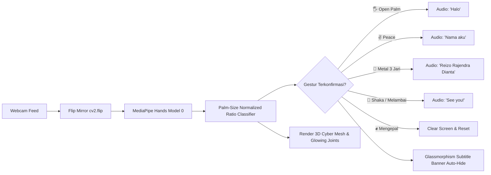

<div align="center">

# ⚡ CYBER GESTURE AI ⚡
### 🖐️ Real-Time Hand Landmark Tracking & Voice Synthesis
**Interactive Self-Introduction System by Reizo Rajendra Dianta**

[](https://www.python.org/)
[](https://mediapipe.dev/)
[](https://opencv.org/)
[](https://www.pygame.org/)
[](https://opensource.org/licenses/MIT)

<p align="center">
  <b>Aplikasi Computer Vision futuristik berbasis AI yang mengenali gestur tangan secara instan di depan webcam, menampilkan efek jaring-jaring 3D hologram neon, dan mengucapkan perkenalan diri dalam Bahasa Indonesia secara otomatis tanpa lag!</b>
</p>

---

</div>

## 🌟 Fitur Utama (Highlights)

- ⚡ **Respon Super Kilat (< 60 ms)**: Deteksi instan hanya dalam 2 frame konfirmasi menggunakan algoritma *Palm-Size Normalized Ratio* yang kebal terhadap jarak kamera dan sudut kemiringan tangan.
- 🟢 **Efek Cybernetic 3D Mesh (Jaring-Jaring Futuristik)**:
  - Titik-titik sendi bercahaya hijau neon terang (`#00FF00`) dengan inti putih berkilau.
  - Garis jaring 3D *webbing* menghubungkan ruas-ruas jari layaknya sarung tangan hologram sci-fi.
  - *Cyber Target Reticle* di pusat telapak tangan yang melacak pergerakan secara dinamis.
- 🗣️ **Text-to-Speech Alami Bahasa Indonesia**: Menggunakan audio *pre-loaded* berkualitas tinggi yang diputar di *background thread* independen sehingga kamera tetap berjalan mulus di **30+ FPS**.
- 🧼 **Layar Bersih & Tampilan Satu-Satu**: Tidak ada tulisan HUD berantakan di bawah. Banner teks subtitle transparan (*Glassmorphism*) muncul elegan di atas hanya saat gestur diucapkan, dan otomatis menghilang setelah 3 detik.
- ✊ **Reset Bersih Seketika dengan Mengepal**: Begitu Anda mengepalkan tangan, banner di atas langsung hilang bersih seketika!

---

## 🖐️ Panduan Gestur Tangan (Gesture Showcase)

| Gestur | Simbol | Posisi Jari | Teks Layar | Suara yang Dihasilkan |
|:---:|:---:|:---|:---:|:---|
| **1** | 🖐️ | **5 Jari Terbuka** (Telapak menghadap kamera) | `Halo` | *"Halo"* |
| **2** | ✌️ | **2 Jari Peace** / ☝️ **1 Jari Telunjuk** | `Nama aku` | *"Nama aku"* |
| **3** | 🤟 | **Metal / Love Sign** (Jempol + Telunjuk + Kelingking) | `Reizo Rajendra Dianta` | *"Reizo Rajendra Dianta"* |
| **4** | 🤙 | **Shaka** (Jempol + Kelingking) / 🖐️ **Melambai di akhir** | `See you!` | *"See you!"* |
| **Reset** | ✊ | **Mengepal (Fist)** | *(Layar Bersih Total)* | *(Reset Sistem)* |

---

## 🧠 Cara Kerja Sistem (Architecture)



---

## 🚀 Instalasi & Cara Menjalankan

### 1. Clone Repository
```bash
git clone https://github.com/Reizo-Rajendra/-AI-Gesture.git
cd -AI-Gesture
```

### 2. Buat & Aktifkan Virtual Environment (Disarankan)
```bash
# Windows
python -m venv .venv
.venv\Scripts\activate

# Linux / macOS
python3 -m venv .venv
source .venv/bin/activate
```

### 3. Install Dependensi
```bash
pip install -r requirements.txt
```

### 4. Jalankan Aplikasi
- **Cara Termudah (Windows)**: Cukup **klik dua kali** file [`run.bat`](run.bat).
- **Dari Terminal**:
  ```bash
  python main.py
  ```
- **Dari Visual Studio Code**: Tekan tombol **`F5`** atau klik ikon **Play (▶️)** di pojok kanan atas file `main.py`.

---

## ⌨️ Kontrol Keyboard

| Tombol | Fungsi |
|:---:|:---|
| `q` atau `Esc` | Menutup jendela kamera dan menghentikan program dengan aman. |
| `c` | Menghapus teks subtitle dari layar secara manual. |

---

## 📁 Struktur Direktori

```
-AI-Gesture/
├── .vscode/               # Konfigurasi otomatis interpreter VS Code
├── audio/                 # File audio MP3 pre-rendered (gTTS Indonesia)
│   ├── halo.mp3
│   ├── nama_aku.mp3
│   ├── reizo.mp3
│   └── see_you.mp3
├── audio_player.py        # Mesin audio non-blocking (Pygame Mixer)
├── gesture_detector.py    # Logika deteksi sendi jari & efek visual jaring 3D
├── main.py                # Pipeline utama kamera, UI rendering & gestur
├── requirements.txt       # Daftar paket dependensi
├── run.bat                # Shortcut sekali klik Windows
└── README.md              # Dokumentasi proyek
```

---

## 👨‍💻 Author

Dibuat dengan dedikasi oleh **[Reizo Rajendra Dianta](https://github.com/Reizo-Rajendra)**  
*Project Trend AI Computer Vision & Audio Interaction.*

---

<div align="center">
  <sub>⭐ Jangan lupa berikan bintang (Star) pada repository ini jika Anda menyukainya! ⭐</sub>
</div>
